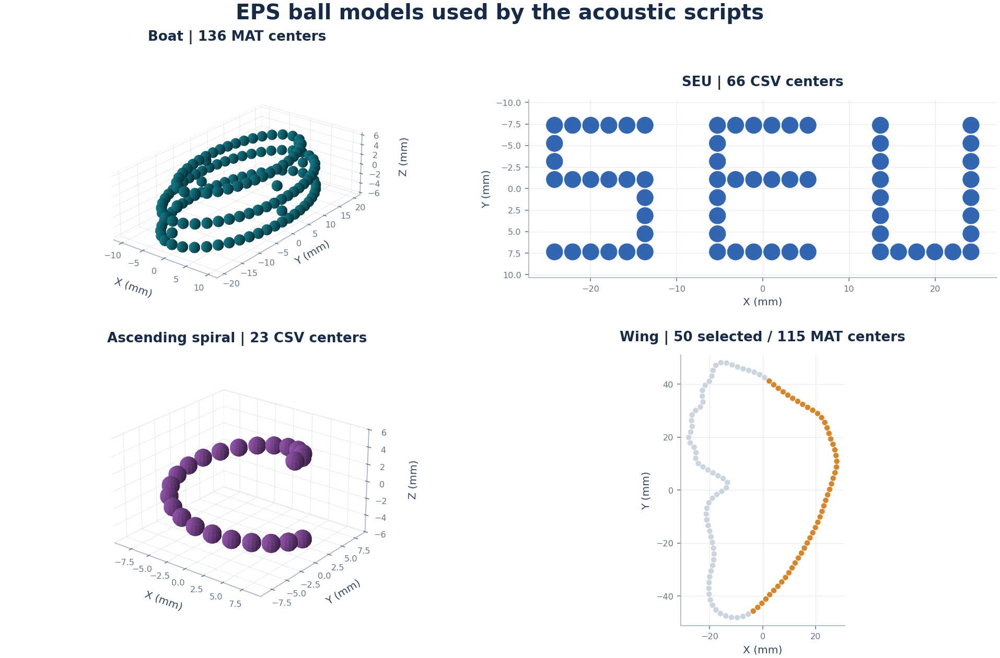
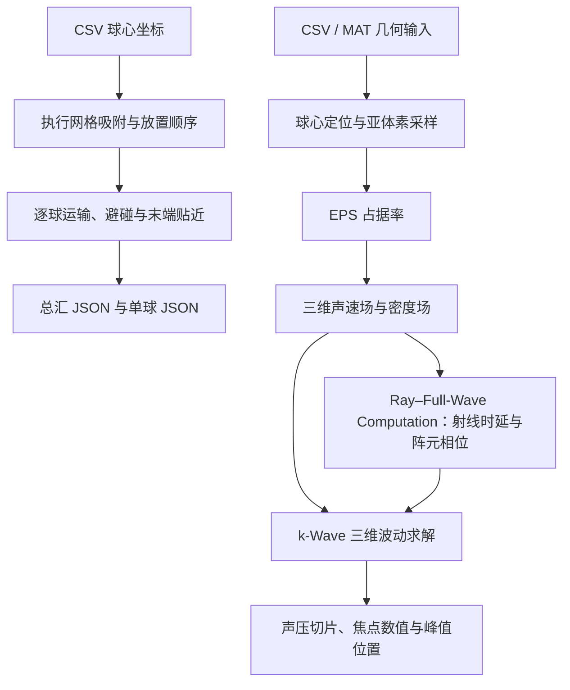
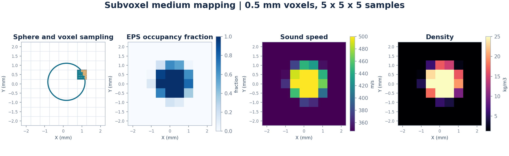
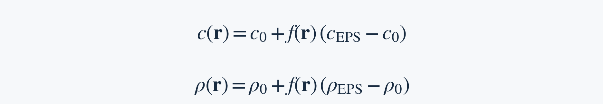
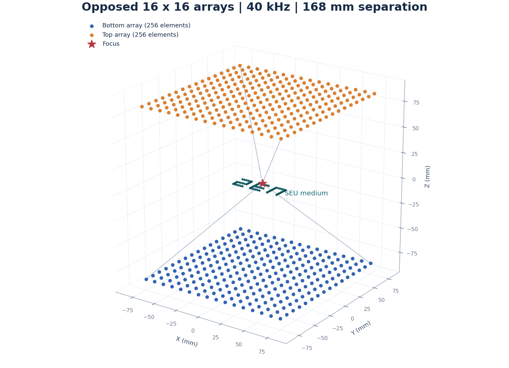
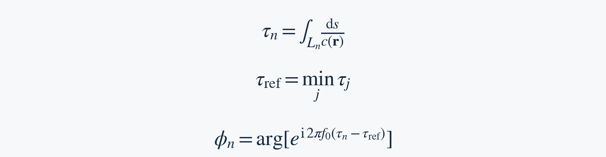

# Ray–Full-Wave Computation

面向 EPS 小球点阵结构的 MATLAB 工具集，覆盖船模型、SEU 字母、上升螺旋和翼形结构的逐球运输路径规划，以及基于亚体素占据率的三维非均匀介质声场计算。

声场计算方法统一命名为 **Ray–Full-Wave Computation**：先沿阵元到焦点的直线路径积分慢度，计算传播时延与激励相位，再调用 k-Wave 求解双对置阵列产生的声压分布。声学介质由 EPS 小球与空气组成。路径规划脚本提供已放置球避碰、多轴运输、末端贴近及可选支撑物约束。



上图由仓库中的球心数据绘制，球阵按包围盒中心对齐显示。翼模型包含 115 个 MAT 球心，其中橙色显示默认选取的前 50 球，浅灰色显示其余球心。

## 目录与入口

```text
.
├── README.md
├── docs/
│   └── images/
│       ├── model_overview.png
│       ├── subvoxel_mapping.png
│       ├── opposed_arrays.png
│       ├── medium_equations.png
│       └── delay_phase_equations.png
├── boat_printing/
│   ├── boat_ball_path_planning.m
│   ├── boat_ball_subvoxel_kwave_simulation.m
│   ├── boat_ball_numbering.csv
│   └── boat_skeleton_bridge_results.mat
├── SEU_printing/
│   ├── SEU_ball_path_planning.m
│   ├── SEU_ball_subvoxel_kwave_simulation.m
│   └── seu_ball_numbering.csv
├── spiral_printing/
│   ├── spiral_ball_path_printing.m
│   ├── ascending_spiral_ball_subvoxel_kwave_simulation.m
│   └── spiral_ball_numbering.csv
└── wing_printing/
    ├── wing_ball_path_planning.m
    ├── wing_ball_subvoxel_kwave_simulation.m
    ├── wing_ball_numbering.csv
    └── butterfly_outer_contour_results.mat
```

| 模型 | 路径规划入口 | 声场仿真入口 |
| --- | --- | --- |
| 船模型 | [boat_ball_path_planning.m](boat_printing/boat_ball_path_planning.m) | [boat_ball_subvoxel_kwave_simulation.m](boat_printing/boat_ball_subvoxel_kwave_simulation.m) |
| SEU | [SEU_ball_path_planning.m](SEU_printing/SEU_ball_path_planning.m) | [SEU_ball_subvoxel_kwave_simulation.m](SEU_printing/SEU_ball_subvoxel_kwave_simulation.m) |
| 上升螺旋 | [spiral_ball_path_printing.m](spiral_printing/spiral_ball_path_printing.m) | [ascending_spiral_ball_subvoxel_kwave_simulation.m](spiral_printing/ascending_spiral_ball_subvoxel_kwave_simulation.m) |
| 翼模型 | [wing_ball_path_planning.m](wing_printing/wing_ball_path_planning.m) | [wing_ball_subvoxel_kwave_simulation.m](wing_printing/wing_ball_subvoxel_kwave_simulation.m) |

## 计算流程



路径规划与声场仿真各自读取配置中的输入文件。进行打印过程与声场的联合分析时，应统一球心坐标、球径、坐标变换、放置顺序和当前已放置球数。

## 运行环境

已验证的 MATLAB 版本为 **R2025a**。声场计算需要安装 **k-Wave**，并将其加入 MATLAB 搜索路径。默认 `run_model = 2` 调用 CUDA 求解器，需要 NVIDIA GPU 与适配的 CUDA 可执行文件。k-Wave 官方要求将 `kspaceFirstOrder-CUDA` 放在工具箱的 `binaries` 目录中。[k-Wave CUDA 接口说明](https://www.k-wave.org/documentation/kspaceFirstOrder3DG.php)

```matlab
addpath(genpath('C:\path\to\k-Wave'));

which kWaveGrid
which kWaveArray
which kspaceFirstOrder3D
which kspaceFirstOrder3DG
```

脚本运行后会在 MATLAB 工作区保留中间变量和计算结果。完整三维网格、分布式声源及求解器工作数组需要较多内存与显存，运行规模应结合设备资源设置。

## 快速开始

### 预览 SEU 几何与介质

在 `SEU_printing/SEU_ball_subvoxel_kwave_simulation.m` 顶部将 `run_model` 改为 `0`，然后从仓库根目录运行。

```matlab
cd('SEU_printing');
run('SEU_ball_subvoxel_kwave_simulation.m');
```

预览模式生成球心变换、占据率、声速和密度切片、占据率等值面、阵列总览、延时图与相位图。SEU 和螺旋仿真脚本均支持此模式。

### 执行声场求解

在所选仿真脚本顶部设置运行模式。

| `run_model` | 运行方式 | 适用脚本 |
| --- | --- | --- |
| `0` | 几何、介质与相位预览 | SEU、螺旋 |
| `1` | `kspaceFirstOrder3D`，MATLAB CPU 求解 | 四个仿真脚本 |
| `2` | `kspaceFirstOrder3DG`，CUDA 求解 | 四个仿真脚本 |

例如，在螺旋脚本中设置 `run_model = 1` 后，从仓库根目录运行。

```matlab
cd('spiral_printing');
run('ascending_spiral_ball_subvoxel_kwave_simulation.m');
```

四个仿真脚本的 `phase_mode` 统一为 `'Ray–Full-Wave Computation'`，用于标识当前计算方法并显示运行信息。通过 `num_balls_to_apply` 选择按输入顺序纳入介质的球数，`inf` 表示使用全部球。翼模型默认取前 `50` 球。

### 执行路径规划

从仓库根目录进入对应文件夹后运行路径脚本，例如船模型。

```matlab
cd('boat_printing');
run('boat_ball_path_planning.m');
```

路径脚本生成包含所有球路径的总汇 JSON，以及逐球 JSON 文件。输出文件夹名称由各脚本的 `outFolder` 指定，采用相对于 MATLAB 当前工作目录的路径。

## 数据来源与默认几何

| 模型 | 随仓库提供的路径 CSV | 仿真默认输入与启用球数 | 仿真球径 |
| --- | --- | --- | --- |
| 船模型 | 146 球 | MAT 中 136 球，默认全部使用 | 2.00 mm，读取 MAT 参数 |
| SEU | 普通 SEU，66 球 | 普通 SEU CSV，默认 66 球 | 2.00 mm |
| 上升螺旋 | 23 个有效球心，其余为空记录 | 螺旋 CSV，默认 23 球 | 2.00 mm |
| 翼模型 | 109 球 | MAT 中 115 球，默认使用前 50 球 | 2.20 mm，读取 MAT 参数 |

各目录中的 CSV 和 MAT 包含不同版本的几何数据。船模型与翼模型默认通过 `ball_data_mode = 'mat'` 读取 MAT 文件，切换为 CSV 时需要同时设置 `sphere_diameter_mm_override`。

**SEU 路径规划**默认启用 `regenerateSEUCsv = true`，会生成独立的 `seu_ball_numbering_rod_front_negX.csv`。该脚本采用 0.95 mm 球半径及贴杆侧布局。普通 SEU 声场输入采用 2.00 mm 球径、2.10 mm 球心距和水平字母布局。

**螺旋路径规划**默认启用 `regenerateSpiralCsv = true`，会将 `spiral_ball_numbering.csv` 重生成为 60 球数据，并按 `numBallsToPlan = 23` 规划前 23 球。若使用仓库随附的 23 球输入，可先将该开关设为 `false` 再运行路径脚本。

**螺旋声场仿真**默认启用 `adjust_center_spacing = true`。随附 CSV 的相邻球心距约为 2.273566–2.276678 mm，脚本保留球数、顺序及各相邻段方向，将每段三维球心距离调整为 `target_pitch_mm = 2.10`。原始坐标保存在 `centers_raw_mm`，变换后的仿真坐标保存在 `centers_sim_mm`。

CSV 坐标列 `x_mm / y_mm / z_mm` 的单位为毫米，声学求解使用米。SEU 与螺旋仿真采用 `[X, Y, Z] → [X, −Z, Y]` 的旋转，再将球阵包围盒中心放置到 `ball_center_target_mm`。船模型与翼模型通过 `ball_rot_xyz_deg` 和 `ball_center_target` 设置姿态与位置。

## 亚体素非均匀介质

每个粗体素内部设置多个子采样点，统计落入球体内的采样点比例，得到占据率 `f`。边界体素因而具有介于 0 与 1 之间的 EPS 体积分数。



上图为直径 2 mm 球体的采样与介质映射示例，采用 0.5 mm 粗网格和每体素 5×5×5 个子采样点，展示中央 Z 切片。

| 仿真脚本 | 默认子采样 | 多球占据率合并 |
| --- | --- | --- |
| 船模型 | 3×3×3 | 粗体素占据率取 `max` |
| SEU | 5×5×5 | 子采样点层面的球体逻辑并集 |
| 上升螺旋 | 5×5×5 | 子采样点层面的球体逻辑并集 |
| 翼模型 | 5×5×5 | `union_prob`，即 `1 − (1 − a)(1 − b)` |

默认 `fractional` 映射采用下式。公式以图片展示，便于在 GitHub 与其他 Markdown 阅读器中直接查看。



其中 `c0`、`rho0` 为空气声速与密度，`cEPS`、`rhoEPS` 为 EPS 的等效参数。当 `f = 0` 时为空气，`f = 1` 时为 EPS。

| 材料 | 声速 | 密度 |
| --- | --- | --- |
| 空气 | 346 m/s | 1.2 kg/m³ |
| EPS 等效材料 | 500 m/s | 25 kg/m³ |

EPS 参数用于当前等效声学模型，实验定量比较需要结合实际材料参数校准。亚体素采样用于细化几何占据率，声波传播仍在粗网格上求解。边界、球间气隙及声场结果的精度应通过求解网格收敛检查评估。

## 双阵列与 Ray–Full-Wave Computation



图中显示阵元中心、SEU 球阵、预设焦点及示例直线路径。阵列参数来自当前脚本配置。

| 参数 | 默认值 |
| --- | --- |
| 激励频率 | 40 kHz |
| 阵列配置 | 上下各 16×16，共 512 个阵元 |
| 阵元直径 / 阵元中心距 | 9 mm / 10 mm |
| 阵列位置 | `z = −84 mm` 与 `z = +84 mm` |
| 阵列间距 | 168 mm |
| 三维网格 | 401×401×341 |
| 网格步长 | 0.5 mm |
| CFL / 仿真时长 | 0.3 / 0.6 ms |
| 单阵元激励幅值 | 1 Pa |

第 `n` 个阵元到焦点的传播时延按直线路径上的慢度积分计算。选取所有阵元中的最短传播时间作为参考，再将相位映射到主值区间。



其中 `L_n` 是第 `n` 个阵元到焦点的直线段，`f0` 是激励频率，`arg` 表示复数相角。对应的 MATLAB 相位计算为：

```matlab
delay_elem = tau_elem - min(tau_elem);
phi_elem = angle(exp(1i * 2*pi*f0 * delay_elem));
```

射线步骤使用声速场估计直线传播时延；全波步骤将声速场、密度场及阵列激励一起交给 k-Wave 求解。这里的射线步骤采用固定直线，不包含折射后的弯曲射线搜索。

随后将相位写入连续波激励，并通过 `kWaveArray` 构造分布式声源。k-Wave 使用三维声速场与密度场进行时域波动计算。[k-Wave 三维求解器说明](https://www.k-wave.org/documentation/kspaceFirstOrder3D.php)

## 输出与验证范围

声场脚本提供介质切片、占据率等值面、阵列与焦点总览、阵元延时和相位分布、`p_max` 与 `p_rms` 切片，以及焦点附近和全域峰值位置。SEU 与螺旋脚本还提供结构中部截面的声压图。

默认声压统计包含仿真起始阶段。SEU 与螺旋脚本可通过 `record_start_s` 配置统计起点，稳态声场分析需要结合传播到达时间与时长收敛性确定统计窗口。

本版本已在 MATLAB R2025a 完成以下检查。

- 8 个代码文件的语法解析及排版前后的可执行语法树一致性检查。
- 船模型 146 球、SEU 66 球、螺旋 23 球、翼模型 109 球的全量路径规划与 JSON 输出检查。
- 输出路径起终点、有限数值及逐段球体避碰检查。
- 四个声场脚本的缩小网格与阵列 CPU 求解测试。
- 路径积分数值回归，以及 A* 支撑物和骨架约束回归测试。

本次文档与命名修订重新检查了全部 8 个 MATLAB 文件，语法解析错误为 0；同时核对了 README 的 13 个本地链接、5 张图片、文本 UTF-8 编码和方法名称的一致性。代码分析器仍有固定配置下不可达分支、未使用变量和性能建议等提示；静态检查不等同于完整设备上的数值验证。

完整尺寸双 16×16 阵列的 GPU 仿真仍需在目标设备上执行。几何图片与亚体素映射图由仓库输入数据及公式绘制，计算结果应以实际脚本运行输出为准。
